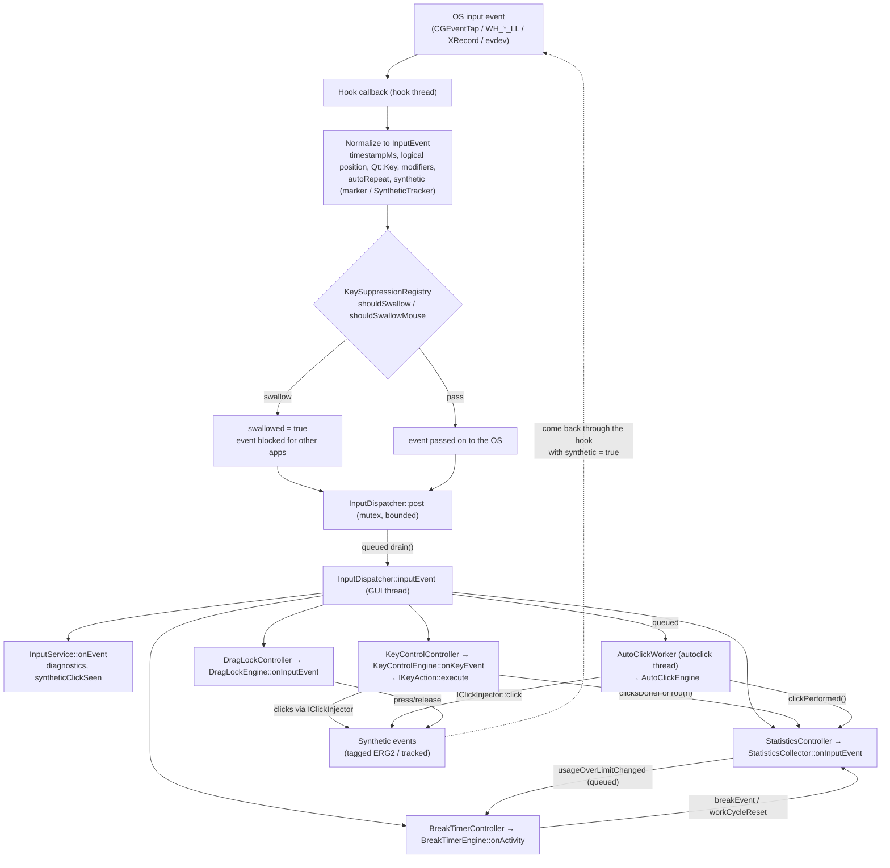

# ErgoPro2 – Architecture (developer guide)

This document describes how ErgoPro2 is built inside: modules, threads, event flow,
lifecycle, hook health, statistics and how to extend Key Control. It matches the
code of version **1.7.9** (`project(ErgoPro2 VERSION ...)` in the root `CMakeLists.txt`).

- Functional specification and project rules: `documentation/implementation_stages.md`
  (Part A = rules, Part B = consolidated specification).
- Build, run, install, permissions, packaging: `documentation/BUILD.md`.
- Manual test checklists: `documentation/initial development docs/MANUAL_TESTS.md`.

All paths below are relative to the repository root. Everything in C++ lives in the
namespace `ergo`.

---

## 1. Overview and design rules

ErgoPro2 is a C++20 / Qt 6.8+ Widgets application (no QML) built with CMake ≥ 3.21.
It installs one global mouse/keyboard hook and offers four functions on top of it:
**Auto Click** (dwell click), **Key Control** (hotkeys that click, toggle Auto Click
or hold a drag lock), **Break Timer** (break reminders with a full-screen break
window) and **Statistics** (per-minute usage records in CSV files).

### 1.1 Three layers

| Layer | CMake target | Directory | May use | Must not use |
|-------|--------------|-----------|---------|--------------|
| core | `ergopro2_core` (static) | `src/core/` | QtCore only | widgets, OS headers, `#ifdef` per OS, real time sources |
| platform | `ergopro2_platform` (static, links core) | `src/platform/` | QtCore + native APIs (CoreGraphics/AppKit/IOKit, Win32, Xlib/XRecord/XTest, libevdev, QtDBus) | widgets |
| ui | `ErgoPro2` executable | `src/main.cpp`, `src/ui/` | everything above + QtWidgets, QtNetwork (QLocalServer), QtSvg | native OS APIs |

Rules (Part A.3 / A.5) and how the code enforces them:

- **core is pure logic.** Every state machine (`AutoClickEngine`, `KeyControlEngine`,
  `DragLockEngine`, `BreakTimerEngine`, `StatisticsCollector`, `HookWatchdog`) is
  driven only by method calls, `InputEvent`s and an injected `IClock`. Engines never
  click, never open windows and never start timers; a GUI-thread *controller* in
  `src/ui/` owns the `QTimer`s and calls the engine. Effects go out through small
  interfaces that the ui layer implements and the tests fake (`KeyActionContext`,
  `IKeyRegistrar`, `IDragLockDevice`).
- **No `#ifdef` per OS outside `src/platform/` and `src/platform/PlatformFactory.cpp`.**
  OS differences outside platform are expressed with values, e.g.
  `OsStyle { MacOS, Windows, Linux }` (`src/core/keycontrol/KeyComboText.h`) for
  key display text and the per-OS reserved-combination list in
  `src/core/keycontrol/KeyComboValidation.cpp`, or with capability queries
  (`IInputHook::canSuppressKeys()`, `IDesktopIntegration::overlayUsesFullScreenState()`, ...).
  OS selection in CMake (`if(APPLE)` / `elseif(WIN32)` / `elseif(UNIX)` in
  `src/CMakeLists.txt`) decides which platform sources are compiled.
- **Platform interfaces** are in `src/platform/PlatformInterfaces.h`:
  `IInputHook`, `IClickInjector`, `IAutostart`, `IInstaller`, `IPermissions`,
  `IPowerEvents`, `IDesktopIntegration`. `createPlatform()` returns a `Platform`
  struct with one `std::unique_ptr` per interface. Every fallible call returns a
  `PlatformResult` (`Ok`, `NotImplemented`, `NotSupported`, `PermissionDenied`,
  `Failed` + message; `src/platform/PlatformResult.h`). An unsupported backend is a
  real object that reports why (`UnsupportedInputHook`, `UnsupportedClickInjector`
  in `src/platform/linux/LinuxInput.h`), never a crash.
- **Injectable clock.** `src/core/Clock.h` defines `IClock` (`now()` = local wall
  clock, `monotonicMs()` = steady clock), `SystemClock` for the app and `FakeClock`
  (`advanceMs()`, `setNow()`) for tests. `monotonicNowMs()` is the shared epoch:
  the platform hooks stamp `InputEvent::timestampMs` with it, so event times and
  `SystemClock::monotonicMs()` are directly comparable. Engines that must see sleep
  as elapsed time (`BreakTimerEngine`, `StatisticsCollector`) use `now()`
  (wall clock); `AutoClickEngine`, `DragLockEngine`, `HookWatchdog` use `monotonicMs()`.
- **Logging categories.** `src/core/LogCategories.h` declares one category per
  module, written as `[module]` in every log line:

  | Category | Name in the log | Used by |
  |----------|-----------------|---------|
  | `lcApp` | `app` | application lifecycle and all feature controllers (Auto Click, Key Control, Drag Lock, Break Timer, Statistics) |
  | `lcLogging` | `logging` | the logger itself |
  | `lcSettings` | `settings` | `SettingsStore`, `SettingsSchema` |
  | `lcPlatform` | `platform` | `src/platform/**`, `InputService` |
  | `lcUi` | `ui` | windows, tray, dialogs |

  All categories are enabled for all levels; filtering is done by `ergo::Logger`
  according to the user's selection (Section 5.3).
- **Errors are never silently ignored** (A.5): failed OS calls are logged with
  context and, if user-relevant, surfaced through `FeatureAvailabilityService`
  (tab banners), message boxes (`AppController::showError`) or tray notifications.

---

## 2. Module map

```
CMakeLists.txt                  Root project: VERSION (single source of truth), options
                                ERGOPRO2_BUILD_TESTS / ERGOPRO2_BUILD_TOOLS /
                                ERGOPRO2_CODESIGN_IDENTITY, ergopro2_warnings, Version.h,
                                CPack (Debian) settings
CHANGELOG.md                    Keep-a-Changelog entries per version (also the release notes)
.github/workflows/ci.yml        Build + test + package on macOS / Windows / Debian, GitHub release
packaging/windows/ErgoPro2.iss  Inno Setup script (Windows setup .exe)
packaging/linux/postinst        Debian post-install note (input group for Wayland)
resources/                      resources.qrc, style.qss, SVG icons, break-tip images,
                                macos/Info.plist.in, windows/ErgoPro2.rc.in, linux/ergopro2.desktop
scripts/                        package-macos.sh, package-windows.ps1, package-linux.sh, generate-icons.sh
tools/icongen/                  Developer tool: renders app.svg to .icns/.ico/.png (ERGOPRO2_BUILD_TOOLS)
tests/                          Qt Test unit tests (CTest), one executable per tst_*.cpp

src/CMakeLists.txt              Targets ergopro2_core, ergopro2_platform, ErgoPro2 (+ install rules)
src/main.cpp                    Entry point: command line, logger, single instance, settings,
                                platform, AppController, event loop, final save

src/core/                       ---- platform-independent logic (QtCore only) ----
  Clock.h                       IClock, SystemClock, FakeClock, monotonicNowMs()
  Version.h.in                  -> <build>/generated/ergopro2/Version.h (ERGOPRO2_VERSION_STRING, ...)
  Logger.h/.cpp                 Thread-safe daily log files, roll-over, retention, Qt message handler, logCritical()
  LogLevel.h/.cpp               LogLevel, cumulative LogLevelSelection (General tab), ids for settings
  LogCategories.h/.cpp          lcApp, lcLogging, lcSettings, lcPlatform, lcUi
  CrashHandler.h/.cpp           installTerminateHandler(), logUncaughtException() -> CRITICAL
  FeatureAvailability.h/.cpp    Feature {AutoClick, KeyControl, BreakTimerActivity, Statistics},
                                PermissionState, FixKind, FeatureStatus, evaluateFeature()
  StartupMode.h/.cpp            decideStartupWindowMode(): show window / hide in tray (W-02)
  LocationClassifier.h/.cpp     Detects running from Temp/Downloads/disk image/translocated (install warning)
  WindowLimits.h/.cpp           windowLimitsFor(): min/start/max (80 %) main window size per screen (1.7.8)
  input/InputEvent.h/.cpp       InputEvent (normalized event), InputEventType, MouseButtonId, Modifier, describeEvent()
  input/KeyCombo.h/.cpp         KeyCombo (key + exact modifiers + keypad), KeySuppressionRegistry
  input/InputDispatcher.h/.cpp  Hook thread -> owner thread hand-over (bounded queue, batched drain)
  input/HookWatchdog.h/.cpp     Pure decision logic: health checks, reinstall spacing, persistent failure
  autoclick/AutoClickEngine.*   Dwell-click state machine (B.4)
  keycontrol/KeyAction.*        OpResult, KeyActionContext, IKeyAction, KeyActionRegistry + built-in actions
  keycontrol/KeyBinding.*       KeyBinding (one configured hotkey), KeyBindingStore (JSON <-> list)
  keycontrol/KeyComboText.*     OsStyle, portable text (settings) and display text (UI) of a KeyCombo
  keycontrol/KeyComboValidation.*  validateCombo(): reserved/rejected/needs-confirmation per OS (B.5.1)
  keycontrol/KeyControlEngine.* Bindings, exclusive registration, per-binding status, fires actions (B.5)
  keycontrol/DragLockEngine.*   Drag Lock state machine (B.5.3), IDragLockDevice
  breaktimer/BreakTimerEngine.* Work time, idle reset, break/postpone, half time above 100 % usage (B.7)
  statistics/StatisticsTypes.*  BreakEvent, MinuteRecord, DayStats, DayTotals, computeTotals()
  statistics/StatisticsCollector.*  Per-second/per-minute recording and usage percent (B.8.1/B.8.2)
  statistics/StatisticsStore.*  Daily CSV files: append, load/repair, day navigation, retention (B.8.4)
  statistics/ChartAxis.*        Chart helpers: hour range, percent axis, 5-minute activity buckets
  settings/SettingsSchema.*     SettingDefinition (Bool/Int/Enum/List), validation, JSON conversion
  settings/SettingsStore.*      settings.json load/validate/save (debounced, atomic), valueChanged()
  settings/SettingsRegistry.*   registerAllSettings(): one registerSettings() call per feature
  settings/GeneralSettings.*    general.* keys
  settings/AutoClickSettings.*  autoclick.* keys
  settings/KeyControlSettings.* keycontrol.actions, draglock.timeoutSeconds
  settings/BreakTimerSettings.* breaktimer.* keys
  settings/StatisticsSettings.* statistics.retentionDays

src/platform/                   ---- OS abstraction ----
  PlatformInterfaces.h          IInputHook, IClickInjector, IAutostart, IInstaller, IPermissions,
                                IPowerEvents, IDesktopIntegration, InputEventSink, MouseButton, PowerEvent
  PlatformResult.h              Result type of every platform call
  PlatformFactory.h/.cpp        struct Platform + createPlatform() (the only #ifdef switch outside platform/<os>)
  common/Synthetic.h            kSyntheticEventMarker ("ERG2"), SyntheticTracker (X11/uinput)
  common/EmergencyRelease.*     Fatal-signal / terminate handlers that release a held drag-lock button
  common/FileOperations.*       removePath(), recursive copy (installers)
  stub/StubPlatform.*           GenericDesktopIntegration (no-op desktop integration, Windows/Linux)
  mac/MacInput.h/.mm            MacInputHook (CGEventTap on a CFRunLoop thread), MacClickInjector (CGEventPost),
                                MacPowerEvents (NSWorkspace / distributed notifications)
  mac/MacPermissions.*          Accessibility (AXIsProcessTrusted) + Input Monitoring (IOHIDCheckAccess)
  mac/MacAutostart.*            LaunchAgent ~/Library/LaunchAgents/com.techforge.ergopro2.plist (no SMAppService)
  mac/MacInstaller.*            Copy to ~/Applications
  mac/MacDesktopIntegration.*   Dock icon policy, activation, break overlay level, full-screen detection
  win/WinInput.*                WinInputHook (WH_KEYBOARD_LL + WH_MOUSE_LL on a message-loop thread),
                                WinClickInjector (SendInput), WinPowerEvents (hidden window thread)
  win/WinPlatform.*             WinInstaller (incl. Inno Setup detection), WinAutostart (HKCU Run),
                                WinDesktopIntegration, WinPermissions
  linux/LinuxInput.h            Declarations of all Linux backends
  linux/LinuxX11Input.cpp       X11InputHook (XRecord + XGrabKey on a poll() thread), X11ClickInjector (XTest)
  linux/LinuxEvdevInput.cpp     Wayland best effort: evdev hook + uinput injector (only with libevdev)
  linux/LinuxPowerEvents.cpp    logind PrepareForSleep / Lock / Unlock and ScreenSaver over D-Bus (only with QtDBus)
  linux/LinuxPlatform.*         LinuxInstaller, LinuxAutostart, LinuxPermissions (session detection, pkexec fix)

src/ui/                         ---- Qt Widgets application ----
  ErgoApplication.*             QApplication::notify() that logs escaped exceptions as CRITICAL
  AppController.*               Creates and wires all services/controllers, window, tray; show/hide/exit/relaunch
  AppContext.h                  References to the shared services (passed to MainWindow and tabs)
  SingleInstance.*              QLockFile + QLocalServer: activate / --quit the running instance
  FeatureAvailabilityService.*  Permissions + runtime requirements -> FeatureStatus per feature, re-check timer
  InputService.*                Owns the global input layer: hook start/stop, dispatcher, suppression
                                registry, watchdog, power events, diagnostics stats
  InstallController.*           Install / Uninstall / restart-from-installed-copy workflow
  PermissionsDialog.*           macOS startup permissions window
  PermissionActions.*           Runs the fix offered for a missing permission
  MainWindow.*                  Tabs, hide-to-tray, window limits (no maximize / full screen)
  TrayController.*              Tray icon (normal / AutoClick active / Drag Lock active) and menu
  Theme.*, TabIcons.*, TextUtils.h  Fusion style + style.qss, light/dark, tab icons
  autoclick/AutoClickController.*  GUI side of Auto Click; owns the worker thread
  autoclick/AutoClickWorker.*   Runs AutoClickEngine in the "autoclick" thread, injects the click
  autoclick/AutoClickOverlay.*  Optional click-through countdown "X" at the pointer
  keycontrol/KeyControlController.*  GUI side of Key Control (Registrar + Context adapters, persistence)
  keycontrol/DragLockController.*    GUI side of Drag Lock (device adapter, timeout timer, emergency release)
  keycontrol/HotkeyDialog.*     Add/Modify hotkey dialog (capture, confirm, action combo)
  breaktimer/BreakTimerController.*  GUI side of the Break Timer (1 s tick, break windows, events)
  breaktimer/BreakWindowManager.*    One BreakWindow per screen
  breaktimer/BreakWindow.*      Full-screen break overlay with countdown, tips, Dismiss/Postpone
  statistics/StatisticsController.*  GUI side of Statistics (feeds the collector, writes CSV, retention)
  statistics/StatisticsCharts.* QPainter charts (usage percent, activity bars)
  tabs/                         GeneralTab (+ InstallCard, DiagnosticsCard, InputDiagnosticsCard),
                                AutoClickTab, KeyControlTab, BreakTimerTab, StatisticsTab
  widgets/                      CardWidget, FeatureBanner, FeaturePage, ParameterRow (slider+spin box),
                                ToggleSwitch, StatusBadge, PlaceholderPage, WheelBlocker
```

---

## 3. Threads

| Thread | Created by | Runs | Talks to others via |
|--------|-----------|------|---------------------|
| **GUI / main** (`QThread` name `main`) | `main()` | Qt event loop, all widgets, `InputService`, `InputDispatcher` (drain + `inputEvent` signal), `KeyControlController`, `DragLockController`, `BreakTimerController`, `StatisticsController`, `FeatureAvailabilityService`, `SettingsStore`, tray | queued signals |
| **Input hook thread** (one `std::thread`) | `IInputHook::start()` | OS event loop of the hook, callback per event | `InputEventSink` → `InputDispatcher::post()`; `KeySuppressionRegistry` (atomics + short mutex) |
| **Auto Click worker** (`QThread` `autoclick`) | `AutoClickController` | `AutoClickWorker` + `AutoClickEngine`, precise `QTimer`s, click injection | queued slots / signals |
| **Windows power thread** (`std::thread`) | `WinPowerEvents::start()` | hidden window + message loop for `WM_POWERBROADCAST` / `WM_WTSSESSION_CHANGE` | callback → `QMetaObject::invokeMethod(..., Qt::QueuedConnection)` in `InputService::start()` |
| **Linux evdev thread** (`std::thread`, Wayland) | evdev hook | `poll()` on `/dev/input/event*`, inotify hotplug, uinput forwarding | as hook thread |

macOS power notifications are delivered on the main queue (`NSNotificationCenter`
observers with `queue:main`), Linux power events come from QtDBus on the GUI thread.
`InputService` still re-posts every power callback queued, so the callback may come
from any thread.

### 3.1 The input hook thread per OS

- **macOS** – `MacInputHook` (`src/platform/mac/MacInput.mm`). A session-level
  `CGEventTapCreate(kCGSessionEventTap, kCGHeadInsertEventTap, ...)` is added to the
  thread's own `CFRunLoop` (`CFRunLoopRun()` until `stop()` calls `CFRunLoopStop`).
  With Accessibility the tap is *active* (`kCGEventTapOptionDefault`: can block
  events); with only Input Monitoring it falls back to *listen-only* (keys cannot be
  blocked, `canSuppressKeys()` = false). A `CFRunLoopTimer` checks
  `AXIsProcessTrusted()` every second (1.7.8, Section 6.4).
- **Windows** – `WinInputHook` (`src/platform/win/WinInput.cpp`). `SetWindowsHookExW`
  for `WH_KEYBOARD_LL` and `WH_MOUSE_LL` on a dedicated thread running
  `GetMessageW`; `stop()` posts `WM_QUIT` with `PostThreadMessageW`. The health
  check posts a private "re-arm" message so the hooks are re-installed on the hook
  thread.
- **Linux X11** – `X11InputHook` (`src/platform/linux/LinuxX11Input.cpp`). Two
  Xlib connections: one for `XRecordEnableContextAsync` (monitoring), one for
  `XGrabKey` (exclusive keys) and `MappingNotify`. The thread `poll()`s both
  connection fds plus a wake pipe, calls `XRecordProcessReplies` and re-grabs keys
  after keymap changes. Other threads run work on it through `Impl::post()`.
- **Linux Wayland** (best effort, only if built with libevdev) – evdev hook in
  `src/platform/linux/LinuxEvdevInput.cpp`: reads `/dev/input/event*` with
  `poll()`, watches hotplug with inotify, grabs keyboards (`EVIOCGRAB`) only while
  keys must be blocked and re-sends all non-blocked keys through a uinput virtual
  keyboard. Pointer devices are never grabbed.

### 3.2 What may run in the hook callback

The callback runs on the hook thread for **every** input event of the session; a slow
callback makes the OS disable (macOS) or silently remove (Windows) the hook. It
therefore only:

1. Builds an `InputEvent` (type, `timestampMs = monotonicNowMs()`, position in
   logical pixels, button, key mapped to `Qt::Key`, modifiers, `autoRepeat`,
   `synthetic`).
2. Asks the `KeySuppressionRegistry` (owned by `InputService`, passed to
   `IInputHook::start()`):
   - `shouldSwallow(event)` for key events – an atomic fast path when nothing is
     registered, otherwise a short `QMutex` over the registered combos. Once a
     key-down is swallowed its auto-repeats and its key-up are swallowed too.
   - `shouldSwallowMouse(event)` for mouse button events – atomics only. Armed while
     a drag lock holds (`setDragLockHolding(true)`): the next real press (any button)
     and its release are consumed (D-03).
   - `isDragLockHolding()` – macOS re-types real `kCGEventMouseMoved` as
     `kCGEventLeftMouseDragged` while a drag lock holds.
3. Calls the sink, `InputDispatcher::post(event)`, and returns "block" or "pass".

No logging I/O, no settings, no Qt signals, no feature logic. Where the OS cannot
block in the callback the decision is still recorded in `InputEvent::swallowed`
(X11: keys are blocked by `XGrabKey`; X11/evdev cannot block mouse clicks:
`canSuppressMouseClicks()` = false).

### 3.3 Crossing threads: `InputDispatcher`

`InputDispatcher` (`src/core/input/InputDispatcher.*`) lives on the GUI thread
(member of `InputService`). `post()` appends to a buffer under a short mutex and
schedules **one** queued `drain()` per batch; `drain()` swaps the buffer out and emits
`inputEvent(const ergo::InputEvent &)` for each event in hook order. The buffer is
bounded (`kMaxPending = 10000`); overflow is dropped and counted
(`droppedCount()`, shown in Input diagnostics).

Subscribers to `InputDispatcher::inputEvent`:

| Subscriber | Thread | Connection |
|------------|--------|------------|
| `InputService::onEvent` (diagnostics stats, `syntheticClickSeen`) | GUI | direct |
| `KeyControlController::onInputEvent` → `KeyControlEngine::onKeyEvent` | GUI | direct |
| `DragLockController` lambda → `DragLockEngine::onInputEvent` | GUI | direct |
| `BreakTimerController::onInputEvent` → `BreakTimerEngine::onActivity` | GUI | direct |
| `StatisticsController` lambda → `StatisticsCollector::onInputEvent` | GUI | direct |
| `AutoClickWorker::onInputEvent` | `autoclick` | queued (automatic, receiver in another thread) |

### 3.4 Auto Click timing

`AutoClickWorker` owns two single-shot `QTimer`s with `Qt::PreciseTimer`, created in
`initialize()` (run on `QThread::started`, so they live in the worker thread). After
every event it calls `schedule()`: the timer is started for
`AutoClickEngine::nextDeadlineMs() - monotonicMs()` or stopped when no click is
pending. On timeout `AutoClickEngine::poll()` decides; on `true` the worker calls
`IClickInjector::click(MouseButton::Left)` **from the worker thread**, emits
`clicked(position)` and waits for the hook to report the click back with
`synthetic = true` (logged at DEBUG). The second timer shows the visual feedback
after half the trigger time of complete stillness (`feedbackShowAtMs()`). Because the
worker does not share the GUI thread, a busy UI does not delay the dwell click.

Click injectors are therefore used from two threads (Auto Click worker, GUI thread
for Key Control / Drag Lock); the X11 injector guards its display with a mutex, the
macOS and Windows injectors use thread-safe OS calls.

### 3.5 Shutdown order

`AppController::exitApplication()` (Exit button, tray Exit, `--quit`, relaunch) and,
identically, `~AppController()`:

1. `StatisticsController::shutdown()` – stops the tick, `flush()`es the open minute and writes it.
2. `BreakTimerController::shutdown()` – closes break windows.
3. `KeyControlController::shutdown()` – `DragLockController::shutdown()` (button up,
   `Reason::AppExit`), then `KeyControlEngine::releaseAll()` (unregister every hotkey).
4. `AutoClickController::shutdown()` – `setEnabled(false)` via `BlockingQueuedConnection`,
   `m_thread.quit()`, `m_thread.wait()`; the worker is deleted on `QThread::finished`.
5. `InputService::stop()` – stops timers, `IPowerEvents::stop()`, `IInputHook::stop()`
   (joins the hook thread; key grabs released).
6. `SettingsStore::saveNow()`, close the window, `QApplication::quit()`.

After `app.exec()` returns, `main()` saves the settings once more, uninstalls the Qt
message handler and returns. `Platform` is declared before `AppController` in
`main()`, so platform objects outlive every controller. `DragLockController` also
releases on `QCoreApplication::aboutToQuit` (logout / fatal paths).

---

## 4. Event flow



Synthetic events:

- **macOS** sets `kCGEventSourceUserData = kSyntheticEventMarker` on every posted
  event; **Windows** sets `dwExtraInfo = kSyntheticEventMarker`
  (`src/platform/common/Synthetic.h`, value `0x45524732` = "ERG2"). The hook compares
  the field and sets `synthetic`.
- **X11** cannot tag events: the injector calls `SyntheticTracker::expect(count, now)`
  and the hook marks that many matching events arriving within 500 ms as synthetic
  (`consume()`); `createPlatform()` gives the X11 hook and injector the same tracker.
- **evdev / uinput** (Wayland): events read from ErgoPro2's own uinput virtual device
  are reported with `synthetic = true`.

Every consumer ignores synthetic events for its logic: `KeySuppressionRegistry`
never swallows them, `KeyControlEngine::onKeyEvent` and `AutoClickWorker` skip them
(the worker only uses them to confirm its own click), the Break Timer does not count
them as activity, the Statistics collector does not record them.

---

## 5. Startup, settings, logging, single instance, crash safety

### 5.1 Startup sequence (`src/main.cpp`, `AppController::start`)

1. `installTerminateHandler()` (uncaught exceptions → CRITICAL), create
   `ErgoApplication`, set organization `techforge`, application `ErgoPro2` and
   version from the generated `ergopro2/Version.h`; name the GUI thread `main`.
2. Parse `--autostart` (set by the login item) and `--quit`.
3. `Logger::open()` into `AppDataLocation/logs`, `Logger::installQtMessageHandler()`.
4. `SingleInstance("ergopro2")`: with `--quit` ask the running instance to exit and
   return 0/1; otherwise `acquire()` → `Primary` continues, `OtherActivated` exits 0,
   `Failed` shows a message and exits 1.
5. `SettingsSchema` + `registerAllSettings()`, `SettingsStore::load()` of
   `AppConfigLocation/settings.json`.
6. `createPlatform()`, `Theme::instance().install(app)`.
7. `AppController::start(loadResult)`:
   1. apply log level / retention, `Logger::cleanupOldFiles()` (startup cleanup);
   2. `setQuitOnLastWindowClosed(false)`;
   3. create `FeatureAvailabilityService`, `InstallController`, `InputService`,
      `AutoClickController`, `KeyControlController` (creates `DragLockController`),
      `BreakTimerController`, `StatisticsController`, `AppContext`, `MainWindow`,
      `TrayController` (if a tray exists);
   4. connect single-instance activation / quit, start the hourly maintenance timer
      (daily log cleanup);
   5. show the window or stay in the tray (`decideStartupWindowMode()`), show the
      macOS permissions window if needed;
   6. start in order: `InputService::start()` → `AutoClickController::start()` (+ tray
      entry) → `KeyControlController::start()` → `BreakTimerController::start()` (+ tray
      entries) → connect `breakWindowShown` → Drag Lock release (D-06) → connect
      `StatisticsController::usageOverLimitChanged` → `BreakTimerController::setUsageOverLimit`
      (queued) → `StatisticsController::start()`;
   7. report settings load problems (message box for corrupt / unreadable file,
      tray message otherwise).
8. `app.exec()`; afterwards a final `settings.saveNow()`.

### 5.2 Settings

- `SettingsSchema` holds a `SettingDefinition` per key (`"<section>.<name>"`, type
  `Bool`/`Int`/`Enum`/`List`, default, range or allowed values). Each feature registers
  its keys in `src/core/settings/<Feature>Settings.cpp`; `registerAllSettings()` in
  `SettingsRegistry.cpp` calls them all.
- `SettingsStore` (`src/core/settings/SettingsStore.*`):
  - `load()`: no file → defaults written (`CreatedDefaults`); unparsable file →
    renamed `settings.corrupt-<yyyyMMdd-HHmmss>.json`, defaults used
    (`RecoveredCorrupt`); unreadable → defaults, saving disabled (`ReadError`); each
    invalid value falls back to its default with a warning (`invalidValues`);
    `schemaVersion` mismatch is logged. `kSchemaVersion = 2` (1.8.2); a version-1 file with the old
    upper-case key names is converted first by `migrateRenamedSettingKeys()`
    (`src/core/settings/SettingsMigration.cpp`).
  - `setValue()` validates, applies at once, emits `valueChanged(key, value)` and
    schedules a save debounced by `kDefaultSaveDelayMs = 300`. Writing uses
    `QSaveFile` (atomic). Unknown keys in the file are preserved.
  - `List` settings (e.g. `keycontrol.actions`) are only checked to be arrays; the
    owning feature validates entries (`KeyBindingStore::fromJson` keeps invalid
    entries with `loadError` and writes them back unchanged).
  - `resetToDefaults()` is used by "Reset all settings"; controllers react through
    `valueChanged` (e.g. Key Control reloads and releases its keys).
- Every controller reads its values with `intValue/boolValue/stringValue` and listens
  to `valueChanged` – there is no other settings path.

### 5.3 Logging

`ergo::Logger` (`src/core/Logger.*`): one file per day `ergopro2-YYYY-MM-DD.log`,
roll-over above 5 MB to `-1`, `-2`, ...; line format
`yyyy-MM-dd HH:mm:ss.zzz [LEVEL] [thread] [module] message` (thread = `QThread`
object name, e.g. `main`, `autoclick`, else the thread id). Thread-safe (one mutex);
debug builds also echo to stderr. Qt messages are mapped as `qDebug`→DEBUG,
`qInfo`→INFO, `qWarning`→WARNING, **`qCritical`→ERROR**, `qFatal`→CRITICAL; a true
CRITICAL line is written with `logCritical()` (used by `CrashHandler`). Old files
are deleted at startup and once per day (maintenance timer / day change), never when
the retention setting changes.

### 5.4 Single instance

`SingleInstance` (`src/ui/SingleInstance.*`) holds a `QLockFile` and listens on a
`QLocalServer`. A second launch sends `activate` (→ `activationRequested` →
`AppController::showMainWindow`); `--quit` sends a quit request (→ `quitRequested` →
`exitApplication`) and waits up to 15 s for the lock to be released.
`AppController::relaunch()` calls `release()` before starting the new process and
re-acquires the lock if starting failed.

### 5.5 Crash safety and emergency release

- `installTerminateHandler()` and `ErgoApplication::notify()` log escaped exceptions
  as CRITICAL (`logUncaughtException`).
- A drag lock holds a real (synthetic) left button down. `DragLockController::start()`
  calls `installEmergencyHandlers()` (`src/platform/common/EmergencyRelease.*`: handlers
  for SIGSEGV, SIGBUS, SIGILL, SIGFPE, SIGABRT, SIGTERM, SIGINT, SIGHUP, the Windows
  unhandled-exception filter and `std::terminate`). While holding,
  `DragLockController::Device::setHolding(true)` arms the handler with
  `IClickInjector::release(MouseButton::Left)`; it is disarmed after the release. The
  handler only posts the button-up (no logging, no Qt, no locks), writes one line to
  stderr and lets the process die as before.
- The drag lock is also released on: hotkey again, timeout, any non-modifier key,
  any mouse click (consumed), break window, Key Control paused/unavailable, binding
  changed, input hook lost, Auto Click switched off, app exit
  (`DragLockEngine::ReleaseReason`).

---

## 6. Hook health

`InputService` (`src/ui/InputService.*`) owns the hook life cycle; decisions come from
the pure `HookWatchdog` (`src/core/input/HookWatchdog.*`, `Config`:
`checkIntervalMs = 30000`, `minReinstallSpacingMs = 5000`, `maxConsecutiveFailures = 3`).

### 6.1 Start

`InputService::start()` starts `IPowerEvents`, then the hook via `tryStartHook()`
unless an OS permission is missing (it then waits: on every
`FeatureAvailabilityService::changed` with no missing permission it tries again).
After a successful start all combos of the suppression registry are registered with
the hook again (X11 grabs). Failures become a runtime requirement `input-hook`
("Global input hook") in `FeatureAvailabilityService`, which shows the banner on
every tab. `statusChanged()` is emitted after every change; the feature controllers
re-evaluate availability on it and `KeyControlEngine::reapply()` re-registers lost keys.

### 6.2 Periodic health check and self-repairs (every 30 s)

`runHealthCheck()`: `healthy = isRunning() && checkHealth()`. `checkHealth()` repairs
in place where possible and counts it in `selfRepairCount()`:

- macOS: re-enables a disabled tap (`CGEventTapEnable`); invalid mach port → unhealthy.
  The tap callback itself also re-enables the tap immediately on
  `kCGEventTapDisabledByTimeout` / `kCGEventTapDisabledByUserInput`.
- Windows: re-arms both low-level hooks on the hook thread every time (Windows removes
  slow hooks without notice); the GUI thread waits at most 2 s (shared promise). Only a
  re-arm that needed a second install attempt counts as a self-repair (1.8.0); modifier
  state is re-read with `GetAsyncKeyState` at every re-arm.
- X11: a round trip (`XSync`) on the hook thread within 2 s; keys are re-grabbed on
  `MappingNotify` (counted as self-repairs).
- evdev: running and at least one device open; devices are rescanned on hotplug.

Self-repair count changes are logged at INFO. `HookWatchdog::onHealthCheck(false)`
returns `Reinstall` (subject to the 5 s spacing).

### 6.3 Reinstalls

`InputService::reinstall(reason)` = `IInputHook::stop()` + `tryStartHook()` (only when
no OS permission is missing) → `HookWatchdog::onReinstallResult(ok)`. Triggers:

- failed health check;
- `PowerEvent::Resume` (`onResume()`) and `PowerEvent::ScreenUnlocked` (`onUnlock()`) –
  always a reinstall, deduplicated by the spacing;
- the hook stopped by itself (Section 6.4).

After 3 consecutive failures `persistentFailure()` is true: logged CRITICAL, shown as
the `input-hook` requirement, and reinstalls continue on later checks. Counters
(`watchdogReinstalls`, `selfRepairs`, `persistentFailure`, `dropped`, `swallowed`) are
shown in General › Input diagnostics.

### 6.4 Permission loss (macOS, 1.7.8)

An *active* event tap without the Accessibility permission can block all input of the
session. Therefore:

- the hook thread's 1 s `CFRunLoopTimer` checks `AXIsProcessTrusted()`; when it is
  gone, `dropTapAfterPermissionLoss()` disables the tap and stops the run loop (the
  hook ends, `isRunning()` becomes false);
- the tap callback never re-enables an active tap without the permission, and
  `MacInputHook::checkHealth()` reports it unhealthy instead of re-enabling;
- `InputService::m_stoppedCheckTimer` (1 s, `checkHookStopped()`) notices a hook that
  stopped by itself, calls `FeatureAvailabilityService::refresh()` (banners), and
  either waits for the permission (runtime message "An OS permission was removed")
  or reinstalls right away when nothing is missing. When the permission is granted
  again, the `changed()` handler from 6.1 starts the hook.

---

## 7. How to add a new Key Control action

Example: a "Middle mouse click" action. Actions are pluggable (B.5.2): one class per
action type, registered in `KeyActionRegistry`; the stored id is the contract with
`settings.json`.

1. **Action id** – `src/core/keycontrol/KeyAction.h`, in `KeyActionRegistry`:
   ```cpp
   static inline const QString MiddleClick = QStringLiteral("middle-click");
   ```
   Ids are stored in `keycontrol.actions[].action`; never rename an existing id.
2. **What the action may do** – if the existing `KeyActionContext` methods
   (`leftClick`, `rightClick`, `doubleLeftClick`, `notifyKeyControlClick`,
   `toggleAutoClick`, `toggleDragLock`, `releaseDragLock`) are not enough, add a pure
   virtual method to `KeyActionContext` (same header), e.g.
   `virtual OpResult middleClick() = 0;`. core must not call platform types, so the
   context is the only way out.
3. **Action class** – `src/core/keycontrol/KeyAction.cpp`, in the anonymous namespace,
   following `LeftClickAction`: implement `id()`, `displayName()` (wrapped in the
   file-local `tr()`, context `"ergo::KeyAction"`), optionally `isVisible()`, and
   `execute()`. A click action calls `c.notifyKeyControlClick()` after a successful
   click so Auto Click treats it like a manual click (B.4 rule 4).
4. **Register it** – `KeyActionRegistry::KeyActionRegistry()` in the same file:
   `add(std::make_unique<MiddleClickAction>());`. The registry order is the order in
   the UI combo.
5. **Implement the context in the app** – `src/ui/keycontrol/KeyControlController.cpp`,
   class `KeyControlController::Context`, e.g.
   ```cpp
   OpResult middleClick() override { return counted(m_platform.clickInjector->click(MouseButton::Middle), 1); }
   ```
   `counted(result, n)` emits `KeyControlController::clicksDoneForYou(n)` on success –
   this is what feeds **Statistics "clicks done for you"** (`StatisticsController`
   connects it to `StatisticsCollector::onClicksDoneForYou`). Count what was actually
   injected (double click = 2, drag-lock press = 1, toggles = 0). If the action needs
   a new platform capability, extend `IClickInjector` in
   `src/platform/PlatformInterfaces.h` and implement it for macOS (`MacInput.mm`),
   Windows (`WinInput.cpp`), X11 (`LinuxX11Input.cpp`), evdev/uinput
   (`LinuxEvdevInput.cpp`) and `UnsupportedClickInjector` (`LinuxInput.h`); tag
   injected events as in Section 4.
6. **UI combo** – nothing to do: `HotkeyDialog` fills its action combo from
   `KeyControlController::selectableActions()` → `KeyControlEngine::availableActionIds()`
   → `KeyActionRegistry::visibleActions()` (one hotkey per action is enforced there),
   and `KeyControlTab` shows `KeyControlController::actionName()`. Only add special
   handling if the action has state shown on the tab (as Drag Lock does in
   `KeyControlTab.cpp`).
7. **Engine rules** – `KeyControlEngine::onKeyEvent` releases an active drag lock
   before any action other than `KeyActionRegistry::DragLock`; review that if the new
   action interacts with the drag lock. `KeyBindingStore::fromJson` accepts the new id
   automatically because it looks it up in the registry.
8. **Tests** – `tests/tst_keycontrol.cpp`: add the new method to the fake
   `KeyActionContext` (`struct FakeContext`, with the counters `left`, `right`,
   `doubles`, ...), assert `KeyActionRegistry().find(KeyActionRegistry::MiddleClick)`,
   that it executes the right context call, that it fires once per key-down (not on
   auto-repeat / synthetic), and that `availableActionIds()` includes/excludes it
   correctly. Run `ctest`.
9. **Docs** – add the action to Part B.5.2 of `documentation/implementation_stages.md`,
   a `CHANGELOG.md` entry with the bumped version (A.4), and a manual test in
   `documentation/initial development docs/MANUAL_TESTS.md`.

---

## 8. Statistics

### 8.1 Inputs of the collector

`StatisticsController` (`src/ui/statistics/StatisticsController.*`, GUI thread) feeds
the pure `StatisticsCollector` (`src/core/statistics/StatisticsCollector.*`):

| Source | Connection | Collector call |
|--------|-----------|----------------|
| Real input events | `InputDispatcher::inputEvent` | `onInputEvent(event)` – synthetic events and events while locked are ignored |
| Auto Click clicks | `AutoClickController::clickPerformed` | `onClicksDoneForYou(1)` |
| Key Control / Drag Lock clicks | `KeyControlController::clicksDoneForYou(n)` | `onClicksDoneForYou(n)` |
| Break events | `BreakTimerController::breakEvent(int)` (`BreakEvent::Shown/Dismissed/Postponed/Completed`) | `onBreakEvent(event)` |
| Sleep / lock | `InputService::powerEventOccurred` | `setLocked(true)` on Sleep / ScreenLocked, `setLocked(false)` on Resume / ScreenUnlocked |
| Work-cycle reset | `BreakTimerController::workCycleReset` (Break Timer state → WaitingForActivity or Disabled) | `onWorkCycleReset()` via `applyNewScale()` |
| Settings | `BreakTimerSettings::MaxWorkMin`, `BreakMin`, `ActivityPauseS` | `setConfig({maxWorkMs, resetAfterMs, pauseAfterMs})` |
| 1 s tick | `QTimer` | `setPixelsPerCm()` (DPI of the screen under the pointer, fallback 96 dpi), `tick()` |

Recorded per second (wall clock): mouse second, keyboard second, active second; per
minute: left/right/other clicks (`MouseDown`), clicks done for you, key presses
(`KeyDown` without auto-repeat; modifiers and hotkeys count), wheel events, mouse
distance in logical px and approximate cm. Never key identities, positions or app names.

### 8.2 Usage percent rules

`usage % = used time / scaleMaxWorkMs × 100` (`percentAt()`):

- The used time counts like the Break Timer's work time: the gap after an input
  counts up to `pauseAfterMs` (`breaktimer.activityPauseSeconds`), then stands still until
  the next input. Nothing counts while the break window is shown
  (`BreakEvent::Shown` stops counting); `Postponed` counts as an input.
- **Reset to 0** when an input arrives after ≥ `resetAfterMs`
  (`breaktimer.breakMinutes`) without input (sleep, lock and app not running count as no
  input because the wall clock runs on), and on `BreakEvent::Completed`.
  `Dismissed` / `Postponed` do not reset; midnight does not reset.
- Above `kMaxPercent = 500` the usage is reset to 0 and `takeCapReset()` reports it
  once (logged at INFO).
- The 100 % scale (`scaleMaxWorkMs()`) takes a changed `breaktimer.maxWorkMinutes` only
  at a usage reset, at `onWorkCycleReset()`, or immediately when the Break Timer's
  active work time is 0 (`StatisticsController` checks `interactionMs() == 0`).
- `StatisticsController::checkUsageLimit()` emits `usageOverLimitChanged(percent > 100)`;
  `AppController` connects it queued to `BreakTimerController::setUsageOverLimit()`,
  so `BreakTimerEngine::effectiveMaxWorkMs()` becomes half of the setting (1.7.6).

### 8.3 Per-minute records

`tick()` closes seconds and minutes the wall clock has passed. A finished minute with
data becomes a `MinuteRecord` (with `usagePercent` at the end of the minute and the
minute's break event tokens), is added to `today()` and queued for `takeFinished()`.
Minutes without data are not written (charts show gaps). On a new local date the
controller logs it, runs the retention cleanup and emits `daysChanged()`.

### 8.4 CSV files

- Folder: `QStandardPaths::AppDataLocation/statistics/`
  (`StatisticsController::defaultDirectory()`), next to `logs/`.
- One file per day: `ergopro2-stats-YYYY-MM-DD.csv`, UTF-8, header line
  (`StatisticsStore::header()`):
  ```
  time,clicks_left,clicks_right,clicks_other,clicks_for_you,key_presses,wheel,mouse_distance_px,mouse_distance_cm,mouse_seconds,keyboard_seconds,active_seconds,usage_percent,events
  ```
  `time` = `HH:MM`, `mouse_distance_px` 0 decimals, `mouse_distance_cm` and
  `usage_percent` 1 decimal, `events` = tokens `break_shown`, `break_dismissed`,
  `break_postponed`, `break_completed` joined with `;`.
- `writeFinished()` appends the finished minutes every tick (grouped per date) and on
  shutdown (`flush()` closes the partial minute first). `StatisticsStore::append()`
  creates folder/file/header as needed and first repairs a partial last line.
  A write failure is logged once per failure streak.
- `StatisticsStore::load()` drops a partial last line (WARNING), skips unreadable
  lines, and merges rows of the same minute (`MinuteRecord::merge`, e.g. after a restart).

### 8.5 Restore after restart

`StatisticsController::restore()` loads today's file into the collector
(`StatisticsCollector::restore(day, lastDataEndMs, lastPercent)`), so the day's totals
continue. The last stored minute of today – or of yesterday if today is empty –
provides `lastDataEndMs` / `lastPercent`; if it ended less than `resetAfterMs` ago and
the percent was > 0, the used time continues from that percent (with the current
`maxWorkMs` as scale). After `start()`, `checkUsageLimit()` runs at once, so a restored
usage above 100 % immediately switches the Break Timer to half time.

### 8.6 Retention

`StatisticsStore::cleanup(retentionDays, today)` deletes files older than
`statistics.retentionDays` (today counts as day 1). It runs at `start()` ("startup")
and on the first tick of a new day ("new day") – never when the setting changes
(1.7.1 rule, same as the log retention).

### 8.7 Tab

`StatisticsTab` reads `StatisticsController::day(date)` (today = live
`m_collector.today()`, other days from the file) and navigates with
`previousDay()` / `nextDay()` (days with a file; today always exists). Charts are
`QPainter` widgets in `src/ui/statistics/StatisticsCharts.*`; axis ranges and the
5-minute buckets come from `src/core/statistics/ChartAxis.*`. The tab updates on
`todayChanged()` (once per finished minute) and `daysChanged()`.

---

## 8a. Keep Screen Active (stage 9, 1.9.0)

| Layer | Piece | Role |
|---|---|---|
| core | `src/core/keepactive/KeepScreenActiveEngine` | Pure state machine (FakeClock-tested in `tests/tst_keepactive.cpp`): enabled flag, real-input time, pause reasons (`Locked`, `BreakWindow`, `DragLock`), `update()` → cycle due; states Disabled / Idle / Working. `keepActiveTitleBarPoint()` = the one place that defines the title-bar click spot. |
| core | `src/core/settings/KeepScreenActiveSettings` | `keepScreenActive.enabled`, `startAfterIdleMinutes`, `intervalMinutes`. |
| core | `KeyActionRegistry::ToggleKeepScreenActive` | Key Control action → `KeyActionContext::toggleKeepScreenActive()`; `KeyControlController` emits `keepScreenActiveToggleRequested()`. |
| platform | `IAppWindows` (`PlatformInterfaces.h`), `Platform::appWindows` | `raise(app)`, `mainWindowFrame(app)`, `clickAt(point)` (pointer moved back), `nudgePointer()`, `unsupportedReason()`. macOS `MacAppWindows.mm`, Windows `WinAppWindows.cpp`, X11 `LinuxAppWindows.cpp` (XTest motions announced with `SyntheticTracker::expectMotion`), Wayland `WaylandAppWindows` in `LinuxEvdevInput.cpp` (nudge through a uinput device named like the click injector's, so the hook marks it as ours). |
| ui | `src/ui/keepactive/KeepScreenActiveController` | GUI thread: real input from `InputDispatcher` (synthetic ignored), power events, `breakWindowShown/Closed`, `DragLockController::holdingChanged`, Key Control bindings (`changed()` → hotkey present / disabled / removed). Ticks every second; a cycle tries Teams, then Zoom (raise → 600 ms → frame → click), else the nudge. Any real input during the 600 ms cancels the click. |
| ui | `AutoClickTab` › card "Keep screen active" | Badge, hotkey, status; visible only while the hotkey exists. |

Every injected event is synthetic, so `StatisticsCollector`, `BreakTimerController` and `AutoClickEngine`
ignore it (they already drop `event.synthetic`), and no "clicks done for you" is emitted.

## 9. Build, tests, packaging, CI and releases

Details and per-OS commands are in `documentation/BUILD.md`; this is the overview.

- **Build**: `cmake -S . -B build -G Ninja -DCMAKE_BUILD_TYPE=Release && cmake --build build`.
  Executables land in `build/bin/` (`ErgoPro2.app` on macOS). Warnings: `-Wall -Wextra`
  / `/W4 /permissive- /utf-8` through the `ergopro2_warnings` interface target.
  macOS signs the bundle after each build with `ERGOPRO2_CODESIGN_IDENTITY` (default
  ad-hoc `-`) so the Accessibility permission is recognized. On macOS SDKs without
  `AGL.framework` the root `CMakeLists.txt` redirects Qt's AGL link to OpenGL.
  Linux needs X11 + libXtst; libevdev (Wayland) and QtDBus (sleep/lock) are optional
  and add `ERGOPRO2_HAVE_LIBEVDEV` / `ERGOPRO2_HAVE_QTDBUS` (used only inside
  `src/platform/linux/`).
- **Version**: only `project(ErgoPro2 VERSION x.y.z)` in the root `CMakeLists.txt`;
  `src/core/Version.h.in` is configured to `<build>/generated/ergopro2/Version.h`.
  Stage = MINOR bump, bug-fix run = PATCH bump, MAJOR stays 1; every change gets a
  `CHANGELOG.md` entry (Part A.4). The packaging scripts read the version from the
  same line.
- **Tests**: `tests/CMakeLists.txt` builds one Qt Test executable per file with
  `ergopro2_add_test()` (links `ergopro2_core`, runs with `QT_QPA_PLATFORM=offscreen`):
  `tst_clock`, `tst_logger`, `tst_settings`, `tst_startupmode`,
  `tst_locationclassifier`, `tst_featureavailability`, `tst_inputevent`,
  `tst_keycombo`, `tst_dispatcher`, `tst_watchdog`, `tst_autoclick`,
  `tst_keycontrol`, `tst_breaktimer`, `tst_draglock`, `tst_statistics`,
  `tst_statisticsstore`, `tst_windowlimits`; on macOS additionally
  `tst_macpowerevents` (links `ergopro2_platform`). Run
  `ctest --test-dir build --output-on-failure`. Time-dependent tests use `FakeClock`.
- **Packaging**:
  - macOS: `scripts/package-macos.sh <build> <out>` → `ErgoPro2-<version>-macos.dmg`
    (copy, `macdeployqt`, re-sign, compressed DMG).
  - Windows: `scripts/package-windows.ps1 -BuildDir <build> -OutDir <out> [-Installer]`
    → `ErgoPro2-<version>-windows-x64.zip` (only the DLLs/plugins actually used + app-local
    MSVC runtime) and, with `-Installer`, `ErgoPro2-<version>-windows-x64-setup.exe`
    from `packaging/windows/ErgoPro2.iss` (Inno Setup, per user, no admin).
  - Debian: `scripts/package-linux.sh <build> <out>` → `cpack -G DEB` →
    `ergopro2_<version>_<arch>.deb` (install rules in `src/CMakeLists.txt`,
    dependencies by `dpkg-shlibdeps`, plus `qt6-svg-plugins`).
  - Icons: `scripts/generate-icons.sh` builds `tools/icongen` and regenerates
    `.icns/.ico/.png` from `resources/icons/app/app.svg` (results are committed).
- **CI** (`.github/workflows/ci.yml`, on push, pull request and manual dispatch):
  jobs `macos` (Qt `6.8.*`, universal `arm64;x86_64` Release, tests, DMG + check),
  `windows` (Qt `6.8.*`, MSVC + Ninja, tests, zip + setup, silent install / `--quit` /
  uninstall check), `linux` (container `debian:trixie` with the distribution's Qt 6
  packages and libevdev, tests, .deb install + start check). Each uploads its package as an artifact.
- **Release** (`release` job, B.9): after a push to `main` and all three jobs green,
  if no release `v<version>` exists yet, it creates the GitHub release
  `ErgoPro2_v<version>` (tag `v<version>`) with the version's `CHANGELOG.md` section
  and the `.dmg`, setup `.exe` and `.deb`. Later pushes with the same version create
  nothing; the portable `.zip` remains a CI artifact only.
